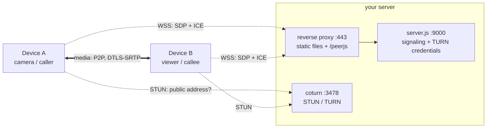

# Architecture

No framework. No bundler. About two thousand lines of plain JavaScript on top of standard
browser APIs. The browser already ships a camera stack, video codecs, an encrypted
real-time transport and a congestion controller. The job is to wire them together and
stay out of their way.

| Layer | What | Why |
|-------|------|-----|
| Capture | `getUserMedia`, `getDisplayMedia` | Camera, mic, screen. Native, hardware-accelerated |
| Transport | WebRTC via [PeerJS](https://peerjs.com/) 1.5 | Peer-to-peer, DTLS-SRTP encrypted, built-in congestion control |
| Signaling | [peer](https://github.com/peers/peerjs-server) (Node) behind a reverse proxy | Swaps SDP and ICE candidates over a WebSocket. Never sees media |
| NAT traversal | [coturn](https://github.com/coturn/coturn) | STUN to find a public address, TURN as a last-resort relay |
| Recording | `MediaRecorder` | WebM/VP9 in memory, exported as a Blob |
| UI | HTML + CSS, [Lucide](https://lucide.dev/) icons, qrcode.js | Vendored in `src/assets/`. No CDN, no remote fonts |

## Two planes

The **signaling plane** is tiny: a few kilobytes of JSON so two browsers can introduce
themselves. The **media plane** carries the megabits, and it doesn't go through your server.

The app is static: one HTML page, one script, one stylesheet, three vendored libraries
and a generated `config.js`. The signaling server runs with `allow_discovery: false`, so
nobody can list who is online.

## Code map

| Path | Role |
|------|------|
| `src/app.html` | App markup (fragment; wrapped into `dist/index.html` by the build) |
| `src/script.js` | Everything: views, camera, viewer, calls, push-to-talk, source switching, filters, adaptive bitrate, recorder, routing |
| `src/style.css` | Styles |
| `src/assets/` | Vendored PeerJS, Lucide, qrcode.js (see `src/assets/LICENSES.md`) |
| `bin/build.sh` | Reads `.env`, writes `dist/`: config, HTML wrapper, manifest, copies. That's the whole build |
| `server/` | `server.js` (signaling + TURN credentials), install scripts for npm, systemd and coturn |
| `config-samples/` | Caddy and nginx examples |

## Views and routing

The app is a single page whose views are toggled by an `active` class. URL hashes are
the entry points, so a QR code or a bookmark lands in the right place:

| Hash | Opens |
|------|-------|
| `#camera` | This device becomes a camera |
| `#viewer` | Viewer, waiting for a code |
| `#cam-xxxxxxxxxxxx` | Viewer, connecting to that camera (what the QR code encodes) |
| `#videocall` / `#audiocall` | Start a 1-to-1 call |
| `#call-xxxxxxxxxxxx` | Lobby to join that call |
| `#record` | Local recorder |

Entry points of apps switched off in `.env` are ignored.
